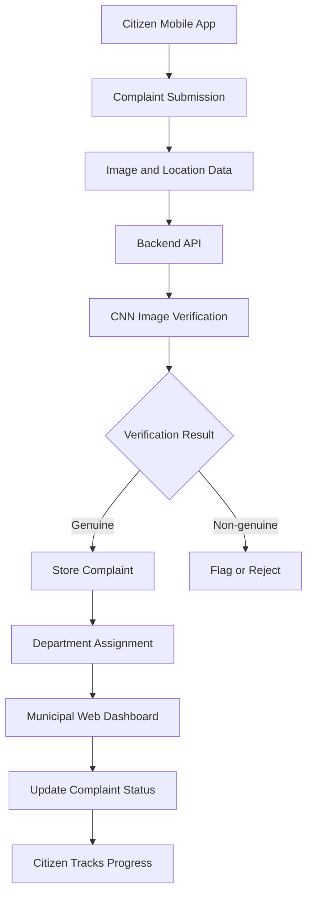

# SUDHAAR — AI-Powered Civic Issue Detection & Verification System

**Using Artificial Intelligence to make civic complaint reporting smarter, faster, and more transparent.**

SUDHAAR is an AI-powered civic technology platform designed to simplify how citizens report local infrastructure and sanitation issues. It combines image-based verification, machine learning, location-aware complaint reporting, and a municipal management workflow to help connect citizens with the departments responsible for resolving civic problems.

Instead of treating civic reporting as just a form submission, SUDHAAR aims to make the process more intelligent—from submitting a complaint to verifying the evidence and tracking its progress.

---

## Overview

In traditional civic complaint systems, reports may require manual verification, can be difficult to categorize, and often provide limited visibility into resolution progress.

SUDHAAR addresses these challenges through an integrated solution consisting of:

- **Citizen Mobile Application:** Submit civic complaints with images, descriptions, and location information.
- **AI-Powered Verification:** Use a computer vision model to assess whether submitted images represent genuine civic issues.
- **Complaint Management:** Organize verified reports and support routing to the appropriate municipal department.
- **Municipal Dashboard:** Provide a centralized interface for reviewing complaints and monitoring their status.
- **Transparent Tracking:** Help citizens follow the progress of their submitted complaints.

## Key Features

### 1. AI-Based Image Verification

- Uses a Convolutional Neural Network (CNN) for image classification.
- Explores transfer learning with MobileNet/MobileNetV2 for efficient image processing.
- Classifies submitted evidence into genuine and non-genuine categories based on the model's predictions.
- Helps reduce reliance on manual image screening.

### 2. Smart Civic Complaint Reporting

- Submit complaint images and descriptions.
- Capture or attach location information.
- Support categorization of civic issues such as potholes, garbage accumulation, and water leakage.
- Organize reports for further review and action.

### 3. Municipal Management Dashboard

- View and manage submitted complaints.
- Review complaint details and associated evidence.
- Track complaint status and resolution progress.
- Support department assignment and location-based complaint monitoring.

### 4. Complaint Lifecycle Tracking

The proposed workflow organizes complaints into stages:

`Submitted → Verified → In Progress → Resolved`

Non-genuine or unsuitable submissions can be flagged for rejection or further review.

### 5. Location-Aware Reporting

Location information helps identify where a civic issue occurred and supports the organization of nearby complaints for municipal follow-up.

---

## System Architecture



The architecture separates the citizen-facing application, backend services, machine learning inference, and municipal management interface.

*Note: This diagram represents the intended end-to-end workflow. Actual integrations depend on the features implemented in the current repository.*

---

## Technology Stack

| Component | Technologies |
|---|---|
| Mobile application | React Native, Expo |
| Backend and APIs | Python, Flask, REST APIs |
| Machine learning | Python, TensorFlow, Keras |
| Computer vision | CNN, MobileNet/MobileNetV2, transfer learning |
| Data processing | NumPy, Pandas |
| Backend services | Firebase, where configured |
| Municipal dashboard | Web application technologies |
| Build and deployment | Expo Application Services (EAS) |

---

## Machine Learning Approach

SUDHAAR uses image classification to support the verification of civic complaints.

### Model pipeline

1. **Image input:** Receive an image submitted with a civic complaint.
2. **Preprocessing:** Resize and normalize the image to match the model's input requirements.
3. **Feature extraction:** Use a CNN-based architecture, with MobileNet/MobileNetV2 transfer learning as the lightweight model approach.
4. **Classification:** Generate a prediction for the genuine and non-genuine classes.
5. **Decision handling:** Use the prediction to support complaint verification before further processing.

### Why MobileNet?

MobileNet is designed for computational efficiency, making it a practical candidate for applications where inference speed and resource usage matter.

Compared with larger CNN architectures, a MobileNet-based model can offer a useful balance between model size, inference performance, and classification quality.

### Dataset and evaluation

The project training work has involved a dataset of approximately 15,000 images.

Model evaluation should include:

- Accuracy
- Precision and recall
- F1-score
- Confusion matrix
- False acceptance and false rejection rates

**Reported project result:** Approximately 92% classification accuracy has been cited during project development. This figure should be included as a final benchmark only when supported by evaluation results on a held-out test dataset.

---

## Application Workflow

1. A citizen submits a civic complaint through the mobile application.
2. The application collects the complaint description, image, and available location information.
3. The backend processes the request and invokes the image verification model.
4. The model prediction supports the verification decision.
5. Eligible complaints are stored and organized for municipal review.
6. The relevant department reviews and updates the complaint.
7. The citizen can track the complaint through its lifecycle.

---

## Project Structure

The following is a suggested logical structure. Adapt it to the actual directories in your repository.

```text
SUDHAAR/
├── mobile-app/          # Citizen mobile application
├── backend/             # API and business logic
├── ml-model/            # Training, evaluation and inference
│   ├── train.py
│   ├── predict.py
│   └── requirements.txt
├── municipality-web/    # Municipal management dashboard
├── docs/                # Architecture and project documentation
├── .gitignore
└── README.md
```

Your actual repository may use a different structure or combine these modules.

---

## Getting Started

### Prerequisites

Install the tools required for the modules you intend to run:

- Node.js and npm
- Python 3.10 or a version compatible with your TensorFlow environment
- Git
- Expo-compatible Android device or emulator

### 1. Clone the repository

```bash
git clone https://github.com/HrutikGujarkar/SUDHAAR.git
cd SUDHAAR
```

Replace the repository URL if your project uses a different GitHub repository name or URL.

### 2. Run the mobile application

Navigate to the directory containing the Expo application's `package.json`:

```bash
cd mobile-app
npm install
npx expo start
```

Follow the Expo CLI instructions to open the application on a compatible device or emulator.

### 3. Set up the machine learning environment

Navigate to the directory containing the model code:

```bash
cd ml-model
python -m venv venv
```

Activate the environment.

**Windows:**

```powershell
venv\Scripts\activate
```

**macOS/Linux:**

```bash
source venv/bin/activate
```

Install the dependencies listed in the project's requirements file:

```bash
pip install -r requirements.txt
```

Run the training or inference scripts according to their implemented arguments and configuration.

### 4. Configure the backend

Install the backend dependencies and configure the required environment variables, Firebase credentials, model paths, and service URLs.

Do not commit private credentials, service account keys, API secrets, or production configuration files to GitHub.

**Important:** The commands above are setup templates. Confirm the actual directory names, entry-point scripts, dependencies, and environment variables before using them as a reproducible installation guide.

---

## Challenges and Engineering Considerations

- Distinguishing genuine civic issues from unrelated or unsuitable images.
- Preventing false positives and false negatives during automated verification.
- Balancing model accuracy with inference speed and resource constraints.
- Handling inconsistent image quality, lighting, and real-world conditions.
- Connecting mobile reporting, backend services, and machine learning inference.
- Designing complaint tracking and department workflows that remain understandable to citizens.

## Future Enhancements

- Multilingual complaint submission and processing.
- Voice-based complaint reporting.
- Duplicate complaint detection using image similarity and geographical proximity.
- NLP-based complaint categorization and priority estimation.
- Real-time notifications for complaint status changes.
- Municipal analytics for identifying recurring civic issues.
- Improved model evaluation across different environments and image conditions.

## Security and Responsible AI

- Protect citizen information and location data.
- Validate uploaded files and API requests.
- Restrict municipal actions according to user roles.
- Treat model predictions as decision-support signals rather than infallible judgments.
- Provide a review path for uncertain classifications and incorrect rejections.
- Keep credentials and sensitive configuration outside the source repository.

## Project Goals

SUDHAAR aims to demonstrate how computer vision, mobile development, backend engineering, and civic workflows can work together to address a real-world public-service challenge.

The broader goal is to make civic complaint reporting more accessible, verification more efficient, and complaint progress more transparent.

## Author

**Hrutik Gujarkar**

B.Tech — Artificial Intelligence and Data Science

- GitHub: [HrutikGujarkar](https://github.com/HrutikGujarkar)

---

*Built as an AI and civic technology project focused on practical problem-solving, responsible automation, and citizen–municipality collaboration.*
